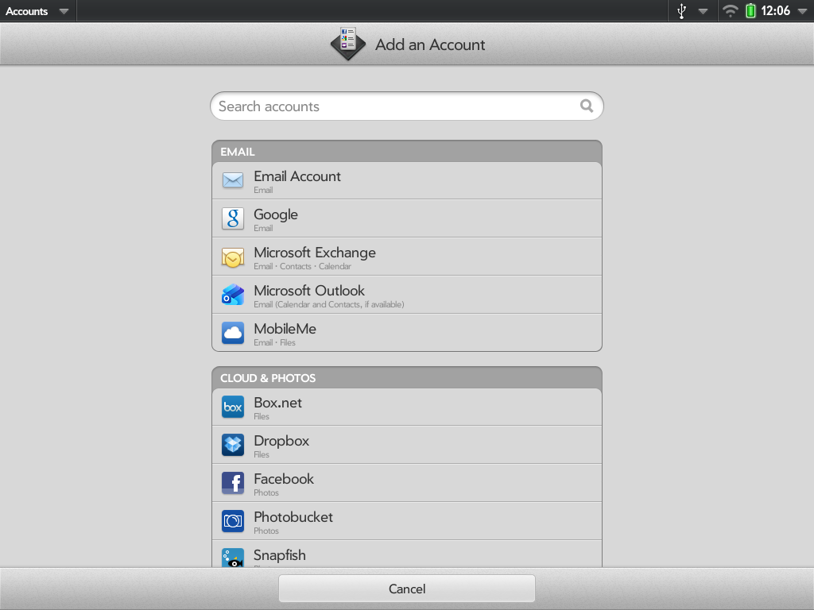
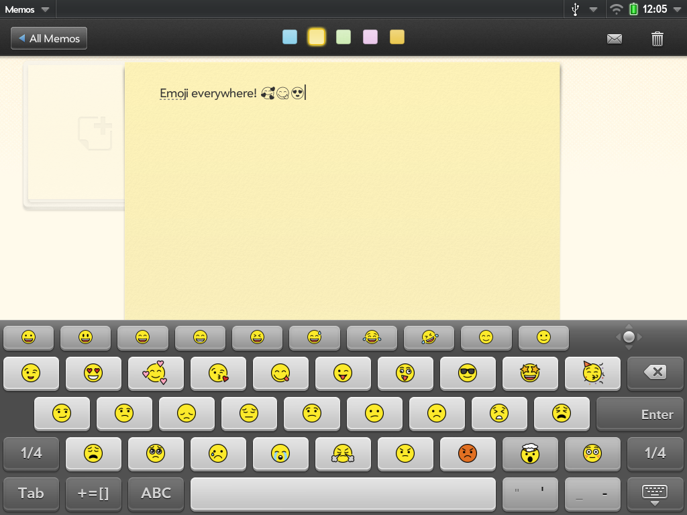
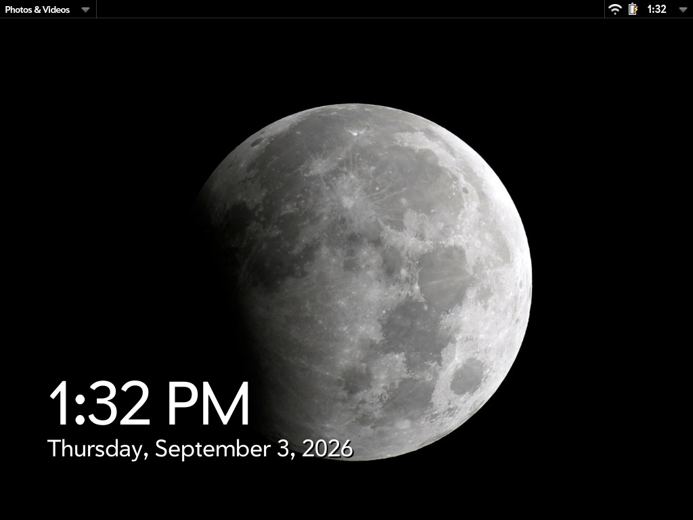

# webOS Community Edition 3.2.0

This follow-up release is available as the first OTA (Over the Air) Update for the [HP TouchPad](https://shop.webosarchive.org/) in more than a decade. Download <a href="https://appcatalog.webosarchive.org/app/OTAReady">OTA Ready</a> on your 3.1.0 TouchPad to start the process. (Not running 3.1.0? [See below](#webos-community-edition-310) for details.)

You can also download 3.2.0 as a Doctor for a full system flash. See Releases for downloads.

<a href="Meta/webOS-Moon-Bright.png">

## Features

webOS CE 3.2.0 adds more features and bugs fixes that were not available in the final commercial release, or from previous community contributions...

### Modern Email
- Add Account offers **Microsoft Outlook** and **Google**.
- **Microsoft 365** (work and school) signs in with a code: the TouchPad shows it, and you  enter it at microsoft.com/device on any device. Mail, contacts and calendar sync over  Exchange ActiveSync.
- **Outlook.com** (personal Microsoft accounts) takes the same sign-in and falls back to  IMAP and SMTP, mail only, without asking twice.
- **Gmail** signs in through webOS Archive's sign-in service. Mail syncs over IMAP with  push (IDLE).
- Tokens refresh by themselves. If access is revoked, Email says "Check your login and  password", and **Change Login Settings → Sign In Again** fixes it.
- Plain-password IMAP and Exchange accounts work as before.

### Typing
- Emoji: the keyboard's language key is now an emoji key, and emoji render (in  monochrome) in apps, web pages and the system UI.
- CE auto-correct: replaces the stock XT9 engine with a modern open source alternative. It is tuned for English.

<a href="Screenshots/Accounts.png">
<a href="Screenshots/Emoji.png">

### System
- **No HP branding**: Following the Luna theme, the boot logo has been replaced, webOS Archive icons and wording, "webOS Account"  and "webOS TouchPad" in place of HP's names.
- USB: connecting shows a "USB Connected" banner and a dashboard item instead of a popup that stays up (like the "Just Charge" patch, but better!)
- No false hotspot sign-in prompt on ordinary Wi-Fi (issue #15).
- Launcher: Video Player sits next to Music, and the Settings tab is alphabetical.

### Apps
- Calculator: rotate to landscape for 24 scientific keys.
- Contacts: Import vCards (2.1, 3.0, 4.0, with photos) to the on-device account built-in
- Calendar: Import Calendar (`.ics`), with rewritten repeating events (UNTIL, COUNT,  cancelled dates, DST changes, Windows zone names). The local calendar is now "On This  Device".
- Time zones now using **tzdata 2026f** (replacing stock timezones from 2011).
- Messaging: a buddy with no linked person no longer shows another thread's unread  count, and a first message from someone who isn't a buddy now gets a conversation.
- Photos can save rotate and crop edits after a fresh flash or a Full Erase.

# webOS Community Edition 3.1.0

This release represents 15 years of cumulative effort to preserve, restore, improve and maintain Palm and HP's mobile webOS. 

Although other versions exist, the most-commonly found modern release was 3.0.5 for the [HP Touchpad](https://shop.webosarchive.org/), with a build date of 2011-12-21.
It was released shortly before HP sold the platform to LG, who use a descendant OS in their Smart TVs. At that time
HP also open-sourced the majority of the OS, making it possible for the community to continue using it -- although without
any of the web services, App Catalog, or other capabilities provided by a manufacturer.

Since that time, the community has built replacement services, modernized the cryptography, preserved and repaired exsting apps,
and built all new apps. This release has two goals:

- Replace the dead components of the OS with repaired or re-invented equivalents
- Provide a new, more modern platform for new and ongoing development

## Supported Devices

This document, and the main release are for *only* **Topaz WiFi**. The Topaz 4G does have a release, but read about [support for the 4G Touchpad](ATT-VARIANT.md) here. These are the most common Touchpad devices, without a cellular radio, at 9.7" screen size.

Do not attempt to install on the 4G-equipped Touchpad, or the smaller Touchpad Go prototypes.

---

## Features

webOS CE 3.1.0 includes features not available in the final commercial release...

### Launcher Improvements

#### Icon Groups

- Icons can now be grouped. Press and hold an icon, then drag it over-top another icon to group it
- Remove icons from a group by opening the group and pressing and holding the icon
- Rename the group by opening it and tapping on the name

<a href="Screenshots/Group-1.jpg">
<a href="Screenshots/Group-2.jpg">

#### Tab Management

- Launcher tabs can now be renamed: press and hold a tab to enter a new name
- The Favorites tab has been renamed to Games by default (Downloads keeps its name)
- New Launcher tabs can now be added: press and hold the empty space next to existing tabs to add a new one
- User-added Launcher tabs can be removed: press and hold the tab, then tap the Trash icon to remove the tab

<a href="Screenshots/TabEdit-1.jpg">
<a href="Screenshots/TabEdit-2.jpg">

#### LunaCE Improvements

All improvements introduced in 2013's LunaCE release are also in webOS CE, including:

- Task management improvements
- Virtual trackball
- Dynamic Dashboard height
- Optional wave launcher
- Tweaks preferences

More details can be found on the [LunaCE Wiki](https://webos-ports.org/wiki/About_LunaCE#Feature_Description)

<a href="Screenshots/Tweaks.jpg">
<a href="Screenshots/JustType-Keyboard-DDG.jpg">

#### Power Control

- Advanced Reset options is now built-in, adding Luna Restart and Reboot options to the Power menu (Shut Down is still present)

<a href="Screenshots/PowerOptions.jpg">

### Exhibition, Screen and Sounds

- **Clock**'s Exhibition mode includes a new and simplified default clock face
- **Photo**'s Exhibition mode now persists preferences and provides an optional time and date overlay
- New wallpapers and the Treo ringtone have been added

<a href="Screenshots/Exhibition-Clock.jpg">
<a href="Screenshots/Exhibition-Photos.jpg">

### Platform Improvements

#### UberKernel

- The stock kernel has been replaced with the community-created **UberKernel**, with the default profile enabled
- Govnah is now pre-installed to allow over-clocking (which has proven safe over the past 15 years)

<a href="Screenshots/UberKernel.jpg">

#### TLS 1.3 and Web

- TLS 1.3 Updates to the browser, mail, and app dev libraries are integrated into the OS.
- Previous TLS Updates in **Preware** will not show as available or compatible, and are not needed
- Future TLS Updates in **Preware** will be separately tested and marked for compatibility with 3.1.0
- Google search has been replaced with DuckDuckGo Lite, which still renders in the Stock browser
- Root certs have been updated
- NTP sync has been fixed
- Modern VPN plug-ins can be found in the **App Catalog**, restoring the built-in VPN app
- **Preware** includes alternate browsers with more modern rendering engines

<a href="Screenshots/TLS-Preloaded.jpg">

#### Bluetooth Device Support

- Wireless Game Controllers can now be paired as "Other" Bluetooth devices
- Previous Bluetooth updates in **Preware** will not show as available or compatible, and are not needed
- Future Bluetooth in **Preware** will be separately tested and marked for compatibility with 3.1.0 

#### USB Device Support

- USB "On the Go" support is enabled, and a new USB Settings app is pre-installed
- A powered USB OTG Y-cable or Hub can be used to connect keyboards, game controllers, and USB storage devices
- The USB Settings app allows mounting, and safely unmounting USB storage
- While the OS does not include a mouse pointer, USB mice are supported if a game or app provides a software mouse-pointer
- Previous USB updates in **Preware** will not show as available or compatible, and are not needed
- Future USB updates in **Preware** will be separately tested and marked for compatibility with 3.1.0
- **Known issue:** on a freshly flashed device the app can report *"Helper not running"* even though it is. Plug in your OTG cable, or flip **High-power devices** on and back off — either one clears it for good. A proper fix will follow through **Preware**

<a href="Screenshots/USBSettings.png">

#### Accounts and Synergy Revival

- The required HP Account has been replaced with an *optional* **webOS Community Account**
- **Activation via deviceTool is no longer required** -- the firstuse out-of-box experience (OOBE) has been repaired, account creation is skippable
- Modernized Synergy components, including libpurple, are pre-installed and enable connectors to modern services
- Find new tested and compatible Synergy plug-ins in **Preware**

<a href="Screenshots/Synergy.jpg">
<a href="Screenshots/OOBE.jpg">

### Pre-loaded Apps

- HP App Catalog has been replaced with **App Catalog**, with a community-run back-end that includes archived historical apps and new community-developed apps
- ****Preware**** is now pre-installed (and can still be updated in the future), with the `modernize` feed pre-enabled.
- The stock **Maps** app has been replaced with a repaired version that uses OSM Maps tiles in place of Bing Maps
- The built-in **Backup** app has been re-written to backup and restore from local storage (replacing the HP Cloud storage service)
- **Help** has been largely repaired, loading content from webOS Archive
- **Photos** now shows a filename for an opened photo
- **Mail** adds support for modern EAS servers

<a href="Screenshots/AppCatalog.jpg">
<a href="Screenshots/Maps.jpg">
<a href="Screenshots/Backup.jpg">

---

## Installation

OS images are restored to webOS devices using a "Doctor" -- a Java based tool that writes the system image to storage, and flashed 
the appropriate hardware controllers.

This release would previously have been called a "Meta Doctor", a community term for modified doctor images. 
However, since this version touches almost every part of the OS, it should be considered a complete Doctor unto itself.

User's may Doctor their Touchpad to the final commercial release, 3.0.5, or to this community release, 3.1.0.

Doctoring a device removes all apps, and resets the device. A community-made Backup app is available to back-up and restore apps.

Downgrading is supported, with the same caveat that apps will be removed.

### Optional: Backup and restore

Note: please consider Backup as a "best-effort" and make sure you know where to find your favorite apps before Doctoring.

**A community created [App Scanner](https://appcatalog.webosarchive.org/app/webOSAppScanner) inventory app can help you identify if your device has apps that have not been archived.**
**Please help us rescue lost apps before you wipe your device!**

The 3.1.0 Backup app is avalable in **Preware**. If upgrading a device with apps, you can install and [run a backup, which can be restored](BACKUP-RESTORE.md) after flashing.

### Install Java on your PC

The Doctor requires a Java runtime. Modern Java is supported on common platforms (Mac, Windows, Linux).

Instructions for installing Java are out-of-scope for this document.

### Install Novacom Drivers

Install Drivers appropriate for your Operating System.

- [https://stacks.webosarchive.org/activation/drivers/](https://stacks.webosarchive.org/activation/drivers/)

### Download the Doctor to your PC

The [Releases section](https://github.com/webOSArchive/webOS-Community-Edition/releases)
includes pre-built Doctor images — one for the Wi-Fi TouchPad, one for the AT&T/4G TouchPad.

Building the image is out-of-scope for this document and will be covered elsewhere.

### Put the Touchpad in Recovery Mode

#### From Powered On

- Hold down the "Home" and "Power" buttons until the device reboots
- Before the device starts, hold the "Volume Up" button until the USB logo is shown

#### From Powered Off

- Hold down the "Power" button until the device turns on
- Quckly hold the "Volume Up" button (before the logo appears) until the USB logo is down

### Connect the Touchpad to your PC

- Use a data-capable micro-USB capable to connect your Touchpad to your PC

### Run the Doctor

- Open a command line and navigate to the folder where the downloaded Doctor is saved
- Run: `java -jar <doctorfilename>.jar`
- Follow the on-screen prompts
    - on a Mac, you may be prompted to re-install the Drivers. You can skip this step (it will error on modern Macs anyway)

### Complete OOBE

- The firstrun will walk you through the Out of Box Experience on-device: join a WiFi network, and create or sign-in to a webOS Community account (or Skip Account Creation)
- Luna will restart
- Give it about 90 seconds to finish first-boot housekeeping (Preware's feeds and
  the IM runtime are seeded then). No reboot is needed — if Preware looks empty
  or the IM transport is missing right after setup, give it a minute.

---

## Problems and Support

- [Report an issue](https://github.com/webOSArchive/webOS-Community-Edition/issues) in this GitHub repo
- Community chat can provide help, visit [docs.webosarchive.org/community](https://docs.webosarchive.org/community/) to find links to join the conversation

## For Developers

To build a Doctor or an OTA update yourself, start with **[BUILDING.md](BUILDING.md)**.
Build notes, design documents and the verification record are in
**[Docs/](Docs/)** — start with [Docs/PLAN.md](Docs/PLAN.md), which indexes them.
